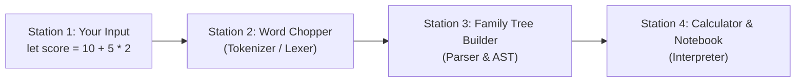

# 🌱 PLang v2.0: The Complete Beginner’s & Presentation Guide
*(No Programming Knowledge Required!)*

Welcome! If you have **zero background in programming or compilers**, or if you want a simple, plain-English guide to understand, run, and present **PLang v2.0** for **CMPSC 132: Programming Languages**, this guide is made for you.

> 🧠 **Want the deep defense guide on "How and Why is PLang its own programming language?"** Check out **[`HOW.md`](HOW.md)** right after reading this guide!

---

## 📖 Table of Contents
1. [What Is This Project in Plain English?](#-1-what-is-this-project-in-plain-english)
2. [How Does It Work? (The 4-Step Kitchen Analogy)](#-2-how-does-it-work-the-4-step-kitchen-analogy)
3. [How Did We Build It WITHOUT `if-else` or Nested `if`s?](#-3-how-did-we-build-it-without-if-else-or-nested-ifs)
4. [Why Does Our Language Get High Grades? (The 3 Big Words)](#-4-why-does-our-language-get-high-grades-the-3-big-words)
5. [Step-by-Step: How to Use & Run PLang (Copy-Paste Guide)](#-5-step-by-step-how-to-use--run-plang-copy-paste-guide)
6. [Cheat Sheet of All Commands & Symbols You Can Type](#-6-cheat-sheet-of-all-commands--symbols-you-can-type)
7. [All Example Files Included (`examples/`)](#-7-all-example-files-included-examples)
8. [Group Presentation Script & Q&A Guide (3–5 Members)](#-8-group-presentation-script--qa-guide-35-members)

---

## 🎯 1. What Is This Project in Plain English?

Computers do not naturally understand human math sentences like:
```text
let total = 10 + 5 * 2
```
To a raw computer, that is just a line of random letters and symbols.

**Our project (`PLang v2.0`) is a custom Programming Language and Translator.**
You type math formulas or English math words (`10 add 5 mul 2`), and PLang:
1. Checks your **spelling** (are those real numbers and symbols?).
2. Checks your **grammar** (did you put a number on both sides of `+`? Did you close your parentheses `()`?).
3. Follows **PEMDAS / BODMAS** order of operations (`5 * 2` happens before `10 + ...`).
4. Saves your named numbers in a **memory notebook** (`total = 20`) and prints the final answer (`[OUT] => 20`).

Even better, you can use PLang in **two ways**:
* **In the Terminal (Command Prompt / PowerShell)** using Python (`python main.py`).
* **In a Web Browser App (Web Studio IDE)** with buttons, visual trees, and live tables (`cd web && npm run dev`).

---

## 🍱 2. How Does It Work? (The 4-Step Kitchen Analogy)

Whenever you type a line like `let score = 10 + 5 * 2`, PLang passes it through **4 assembly-line stations**:



### Station 1: Your Input (`main.py` or Web Editor)
You type a line in the terminal (`plang> `) or load a `.plang` file from the `examples/` folder.

### Station 2: The Word Chopper — "Lexical Analyzer / Tokenizer" (`tokenize` in `lang.py`)
* **Real-Life Analogy**: Imagine cutting a sentence up with scissors so every word or symbol sits on its own labeled flashcard.
* **What it does**: It chops `let score = 10 + 5 * 2` into flashcards called **Tokens**:
  * `[LET: "let"]`, `[IDENT: "score"]`, `[ASSIGN: "="]`, `[NUMBER: "10"]`, `[ADD: "+"]`, `[NUMBER: "5"]`, `[MUL: "*"]`, `[NUMBER: "2"]`
* **Why it’s smart**:
  * If you type the English word `add` instead of `+`, the Word Chopper gives both of them the exact same `[ADD]` flashcard!
  * **Catches Typos ("Lexical Errors")**: If someone types an illegal symbol like `10 @ 5` or a broken number like `12.34.56`, Station 2 stops immediately and points an arrow (`^`) at the bad character.

### Station 3: The Grammar & PEMDAS Organizer — "Parser" (`Parser` in `lang.py`)
* **Real-Life Analogy**: Having flashcards isn't enough—you need to arrange them in the right order so **Multiplication (`5 * 2`) happens BEFORE Addition (`10 + ...`)**.
* **What it does**: It builds an upside-down family tree called an **AST (Abstract Syntax Tree)**. Whatever is placed **deepest at the bottom of the tree gets calculated first**:
  ```text
  AssignNode('score' =)
  └── BinOpNode(ADD '+')
      ├── NumberNode(10 : int)
      └── BinOpNode(MUL '*')        <-- At the bottom, so 5 * 2 is solved FIRST!
          ├── NumberNode(5 : int)
          └── NumberNode(2 : int)
  ```
* **Catches Broken Sentences ("Syntax / Format Errors")**: If someone writes `10 + * 5` (missing a number between `+` and `*`) or `(10 + 5` (forgetting the closing `)`), Station 3 catches it and explains how to fix the format.

### Station 4: The Calculator & Notebook — "Interpreter" (`Interpreter` in `lang.py`)
* **Real-Life Analogy**: A mathematician who climbs the family tree from the bottom to the top, calculates each branch, and writes saved answers in a **Notebook** (called the **Symbol Table**).
* **What it does**:
  1. Solves the bottom branch: `5 * 2` = `10`.
  2. Solves the upper branch: `10 + 10` = `20`.
  3. Writes `score = 20` inside its Notebook (`variables`).
* **Catches Math Impossibilities ("Runtime Errors")**: What if someone writes `100 / (5 - 5)`? The spelling and grammar are fine, so Stations 2 and 3 pass! But when Station 4 calculates `5 - 5 = 0`, it realizes **you cannot divide by zero**, stops safely, and prints a helpful hint.

---

## 🧩 3. How Did We Build It WITHOUT `if-else` or Nested `if`s?

Usually, beginners write calculators with a giant chain of `if-else` questions:
> *"If the symbol is `+`, add them. Else if the symbol is `-`, subtract them. Else if the symbol is `*`, multiply them..."*

In our project, **`if-else` statements and nested `if`s are strictly forbidden**. How did we make a whole programming language without them? We used **3 clever tricks**:

### Trick 1: The Vending Machine / Phonebook Trick (Dictionary Dispatch Tables)
Instead of asking 10 `if-else` questions, think of how a **vending machine** works: you press code `"add"`, and it directly triggers the Addition slot!
* In Python, we use a **Dictionary** (a lookup table) paired with Python's built-in **`operator` library** (`operator.add`, `operator.sub`, `operator.mul`, etc.):
  ```python
  self._binary_op_dispatch = {
      "add": lambda a, b, ln, col: operator.add(a, b),
      "sub": lambda a, b, ln, col: operator.sub(a, b),
      "mul": lambda a, b, ln, col: operator.mul(a, b),
      ...
  }
  ```
* When PLang sees `"add"`, it looks up `"add"` in the table and runs `operator.add(a, b)` in one step—no `if-else` needed!

### Trick 2: The "Self-Service Job Badge" Trick (Polymorphism)
Instead of the Interpreter asking every tree piece *"If you are a Print command, print; else if you are a Number, return your number; else if you are an Addition, add..."*, every tree node class (`NumberNode`, `BinOpNode`, `PrintNode`, `AssignNode`) has its own built-in `.execute()` and `.evaluate()` method.
* The Interpreter simply says:
  ```python
  return stmt.execute(self)
  ```
* Each piece automatically performs its own job! In Computer Science, this is called **Polymorphism**.

### Trick 3: Single "Bouncer at the Door" Checks (Flat Guard Clauses)
Whenever we check for an error (like checking if a divisor is `0`), we use a single, flat check that immediately stops and raises the error:
```python
if right_val == 0:
    raise InterpreterError("divide_by_zero", ...)
```
Because it stops immediately, we **never** need an `else` block and we **never** put an `if` inside another `if`!

---

## 🏆 4. Why Does Our Language Get High Grades? (The 3 Big Words)

In CMPSC 132, programming languages are graded on **Robert W. Sebesta’s 3 Evaluation Criteria**:

1. **Readability (How easy is it to read and understand?)**
   * You can write standard math (`10 + 20 // 3`) **OR** plain English words (`10 add 20 div 3`).
   * Writing `let price = 50` makes it crystal clear that you are creating a variable named `price`.
   * Typing `vars` shows a neat table of all your saved numbers and whether each one is an `integer` or `float`.

2. **Writability (How fast and easy is it to write code?)**
   * Zero setup clutter—you don't need to write `public static void main` just to add two numbers!
   * Shortcuts like `x += 5` (add 5 to `x`) and built-in functions like `sqrt(25)`, `abs(-10)`, `min(1, 5, 9)`, and `max(1, 5, 9)` save time.
   * The last answer is automatically saved in a special variable called `ans`.

3. **Reliability (Does it behave safely and predictably without crashing?)**
   * **Whole numbers stay whole numbers**: `10 + 5` is `15` (an exact integer), not `15.0`.
   * **Never crashes with ugly computer gibberish**: Any typo, format mistake, or division by zero shows the exact Line, Column, a visual `^` arrow pointing at the mistake, and a friendly `Hint:`.

---

## 🚀 5. Step-by-Step: How to Use & Run PLang (Copy-Paste Guide)

Open **PowerShell** or **Command Prompt** inside the `plang` project folder (`C:\Users\TUF\OneDrive\Desktop\DOST Replica\plang`).

### Way 1: Use the Interactive Calculator Prompt (REPL)
Type this command and press **Enter**:
```powershell
python main.py
```
You will see the `plang> ` prompt! Now you can type lines one by one:
```text
plang> 10 + 5 * 2
  [OUT] => 20
plang> let apples = 15
plang> let oranges = 10
plang> print apples add oranges
[OUT] => 25
plang> vars
  +----------------------+------------+----------------------+
  | Variable Identifier  | Data Type  | Current Value        |
  +----------------------+------------+----------------------+
  | ans                  | integer    | 25                   |
  | apples               | integer    | 15                   |
  | oranges              | integer    | 10                   |
  +----------------------+------------+----------------------+
plang> ast 10 + 5 * 2
  [Abstract Syntax Tree (AST)]
  Program
  └── BinOpNode(ADD '+')
      ├── NumberNode(10 : int)
      └── BinOpNode(MUL '*')
          ├── NumberNode(5 : int)
          └── NumberNode(2 : int)
plang> exit
```

### Way 2: Run Ready-Made Example Files
Copy and paste any of these commands into your terminal:
```powershell
# 1. Beginner step-by-step tutorial
python main.py examples/step_by_step_basics.plang

# 2. Integer arithmetic & PEMDAS order of operations
python main.py examples/integer_arithmetic.plang

# 3. English word operators (add, sub, mul, div, mod, pow)
python main.py examples/hybrid_syntax.plang

# 4. Shortcuts (+=, -=) and math functions (sqrt, abs, min, max)
python main.py examples/advanced_features.plang

# 5. Real-world formulas (Grades, Shopping Change, Geometry)
python main.py examples/real_world_formulas.plang

# 6. Error handling demo
python main.py examples/error_handling_demo.plang
```
💡 **Pro Tip for Presentations**: Add `--tokens --ast` to the end of any command above to show the Flashcards (Tokens) and Family Tree (AST) automatically!
```powershell
python main.py examples/integer_arithmetic.plang --tokens --ast
```

### Way 3: Open the Visual Website (Web Studio IDE)
If you want to show the visual browser version:
```powershell
cd web
npm run dev
```
Then Ctrl+Click the `http://localhost:5173` link shown in the terminal!

---

## 📋 6. Cheat Sheet of All Commands & Symbols You Can Type

| What You Want to Do | Math Symbol Way | English Word Way | Example & Output |
| :--- | :--- | :--- | :--- |
| **Add** | `a + b` | `a add b` | `10 + 5` $\rightarrow$ `15` |
| **Subtract** | `a - b` | `a sub b` | `20 sub 8` $\rightarrow$ `12` |
| **Multiply** | `a * b` | `a mul b` | `6 * 7` $\rightarrow$ `42` |
| **Decimal Division** | `a / b` | — | `7 / 2` $\rightarrow$ `3.5` |
| **Whole-Number Division** | `a // b` | `a div b` | `47 // 10` $\rightarrow$ `4` |
| **Remainder (Modulo)** | `a % b` | `a mod b` | `47 mod 10` $\rightarrow$ `7` |
| **Power / Exponent** | `a ^ b` or `a ** b` | `a pow b` | `2 ^ 3` $\rightarrow$ `8` |
| **Save a Variable** | `let x = 10` | `x = 10` | Saves `x` as `10` |
| **Update a Variable** | `x += 5`, `x -= 2`, `x *= 3`, `x /= 2` | — | Updates `x` in place |
| **Print an Answer** | `print(x)` | `print x` | `[OUT] => 10` |
| **Square Root** | `sqrt(25)` | — | `5` |
| **Absolute Value** | `abs(-42)` | — | `42` |
| **Smallest / Largest** | `min(4, 9, 2)`, `max(4, 9, 2)` | — | `2` / `9` |
| **Round to Integer** | `round(3.7)` | — | `4` |
| **Show Notebook Table** | `vars` | `vars` | Prints all saved variables |
| **Erase Notebook** | `clear` | `clear` | Clears all saved variables |

---

## 📂 7. All Example Files Included (`examples/`)

| File Name | What It Demonstrates |
| :--- | :--- |
| [`examples/step_by_step_basics.plang`](examples/step_by_step_basics.plang) | Baby-step walkthrough of numbers, `let`, `print`, `ans`, and `vars` for first-time users. |
| [`examples/integer_arithmetic.plang`](examples/integer_arithmetic.plang) | Requirement II.1: Exact integer math, PEMDAS precedence, parentheses, `//`, and `%`. |
| [`examples/hybrid_syntax.plang`](examples/hybrid_syntax.plang) | Readability: Mixing English keywords (`add`, `sub`, `mul`, `div`, `mod`, `pow`) with math. |
| [`examples/advanced_features.plang`](examples/advanced_features.plang) | Writability: Compound operators (`+=`, `*=`), `sqrt`, `abs`, `min`, `max`, and `vars`. |
| [`examples/real_world_formulas.plang`](examples/real_world_formulas.plang) | Practical everyday math: Student Grade Average, Bill & Coin Change Splitter, and Right Triangle Hypotenuse. |
| [`examples/error_handling_demo.plang`](examples/error_handling_demo.plang) | Requirement II.2: Ready-to-uncomment lines demonstrating Lexical, Syntax, and Runtime errors with visual `^` pointers. |

---

## 🎤 8. Group Presentation Script & Q&A Guide (3–5 Members)

### Speaker 1: Introduction & The 3 Evaluation Criteria
> *"Good day! We created **PLang v2.0**, a custom arithmetic programming language with both a Python CLI/REPL and a React Web IDE. We designed it around Sebesta’s three criteria: **Readability** (supporting both standard symbols like `+` and `//` and English words like `add` and `div`), **Writability** (zero boilerplate, shortcuts like `+=`, and built-in math functions), and **Reliability** (strict PEMDAS order of operations, exact integer preservation, and visual caret error messages)."*

### Speaker 2: How the 4-Stage Pipeline & Libraries Work
> *"When you run code in PLang, it goes through 4 stages in `lang.py`:*
> 1. *First, our **Tokenizer** uses Python’s `re` (Regular Expression) library to chop raw text into tokens and catch bad characters or malformed numbers like `12.34.56`.*
> 2. *Second, our **Recursive-Descent Parser** checks grammar rules and builds an **Abstract Syntax Tree (AST)** where higher-precedence operations like `^` and `*` sit deeper in the tree so they are evaluated first.*
> 3. *Third, our **Interpreter** uses Python's `operator` and `math` libraries to evaluate the tree and store variables in a Symbol Table."*

### Speaker 3: How We Eliminated `if-else` and Nested `if`s
> *"To comply with the rule against `if-else` chains and nested `if` statements, we used three Programming Language patterns:*
> 1. ***Polymorphism**: Every AST node class (`NumberNode`, `BinOpNode`, `PrintNode`, `AssignNode`) defines its own `.evaluate()`, `.execute()`, and `.format_tree()` methods—so the interpreter just calls `stmt.execute(self)` without any `if-elif-else` type checks.*
> 2. ***Dictionary Dispatch Tables**: We map operators and keywords directly to functions in dictionaries (using Python's `operator.add`, `operator.mul`, etc.) instead of `if-else` branches.*
> 3. ***Flat Guard Clauses**: Every error check is a single, un-nested `if` that immediately raises an error. We even wrote an automated test (`test_no_if_else_or_nested_ifs`) using Python’s `ast` module that proves our engine has zero `if-else` and zero nested `if`s."*

### Speaker 4: Live Demo (CLI + Web IDE)
1. Run `python main.py examples/real_world_formulas.plang --ast` to show real calculations and the ASCII AST tree.
2. Run `python main.py`, type `10 + * 5` and `10 / 0` to show how errors are caught cleanly with `^` pointers without crashing.
3. Run `python -m pytest test_lang.py -v` to show all 8 test suites passing.
4. Show the **Web Studio IDE** (`http://localhost:5173`) to demonstrate the visual AST tree, Token table, and Handbook.
