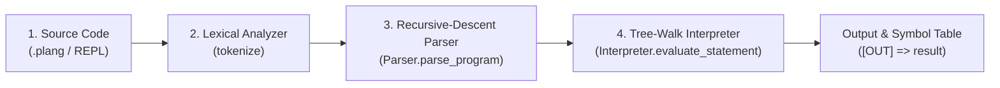

# PLang v2.0: A Readable, Writable, and Reliable Arithmetic Programming Language

[](#)
[](#)
[](#)

**PLang v2.0** is a custom-designed arithmetic programming language and dual-interface interpreter system (**Python CLI/REPL** + **Interactive React Web IDE**).

It is engineered from the ground up TO MEET the three foundational Programming Language Evaluation Criteria: **Readability**, **Writability**, and **Reliability**.

---

## 📌 Table of Contents
1. [What Is This Project About?](#-1-what-is-this-project-about)
2. [Languages & Tech Stack](#-2-languages--tech-stack)
3. [How the Project Works (Compiler/Interpreter Pipeline)](#-3-how-the-project-works-compilerinterpreter-pipeline)
4. [Language Design: Readability, Writability & Reliability](#-4-language-design-readability-writability--reliability)
5. [PLang v2.0 Syntax, Operators & Built-in Functions](#-5-plang-v20-syntax-operators--built-in-functions)
6. [Formal EBNF Grammar Specification](#-6-formal-ebnf-grammar-specification)
7. [Installation & How to Use](#-7-installation--how-to-use)
8. [Sample Programs & Expected Outputs](#-8-sample-programs--expected-outputs)
9. [Error Handling & Visual Caret Diagnostics](#-9-error-handling--visual-caret-diagnostics)
10. [Project Directory Structure](#-10-project-directory-structure)

---

## 🎯 1. What Is This Project About?

The goal of **PLang v2.0** is to design and implement a complete, human-centric programming language capable of evaluating arithmetic expressions (with a strict guarantee on exact integer arithmetic as well as floating-point precision), managing stateful variables, and providing clear, reliable error diagnostics when given malformed or invalid input. Basically just to fulfill the projects requirement :>

Instead of scattering syntax across conflicting character based themes—which introduces *feature multiplicity* and harms readability—**PLang v2.0** implements a **unified hybrid syntax**:
* Developers can write standard symbolic math (`let x = 10 + 5 * 2`) **or** self-documenting English operator keywords (`let x = 10 add 5 mul 2`).
* Every stage of execution—from **Lexical Tokenization** to **Abstract Syntax Tree (AST) Construction** and **Symbol Table Evaluation**—can be inspected live in both the **Command-Line Interface (CLI)** and the **Browser Web IDE**.

---

## 💻 2. Languages & Tech Stack

This repository uses two host implementation languages to power **PLang v2.0** across terminal and browser environments:

| Component | Language / Framework | Role in the Project |
| :--- | :--- | :--- |
| **Target Language** | **PLang (`.plang`)** | Our custom hybrid arithmetic programming language with variables, functions, and REPL commands. |
| **Core CLI & REPL Engine** | **Python 3** (`re`, `math`, `operator`, `argparse`, `json`) | Implements the reference tokenizer, recursive-descent parser, polymorphic AST nodes, table-driven interpreter, and terminal REPL ([`lang.py`](lang.py), [`main.py`](main.py)). |
| **Automated Test Suite** | **Python (`pytest`, `ast`)** | 8 comprehensive test suites verifying integer/float arithmetic, precedence, hybrid keywords, error trapping, and architectural compliance ([`test_lang.py`](test_lang.py)). |
| **Interactive Web Studio IDE** | **JavaScript (ES6+), React 19, Vite, TailwindCSS** | Browser-based IDE featuring a code editor, interactive console, live AST & token inspector, variable state monitor, and language handbook ([`web/`](web/)). |

---

## ⚙️ 3. How the Project Works (Compiler/Interpreter Pipeline)

Whenever you run a `.plang` script or enter a command in the REPL, **PLang** processes your code through a deterministic **4-Stage Interpreter Pipeline**:



1. **Stage 1 — Source Code Input**: Reads raw source text from a `.plang` file, the terminal REPL (`plang> `), or the Web IDE editor.
2. **Stage 2 — Lexical Analysis (`tokenize`)**:
   * Scans the source string using a prioritized regular-expression state machine.
   * Strips comments (`# ...`) and whitespace while tracking exact `line` and `column` coordinates for every token.
   * Normalizes hybrid English keywords (`add`, `sub`, `mul`, `div`, `mod`, `pow`) into canonical operator tokens (`ADD`, `SUB`, `MUL`, `IDIV`, `MOD`, `POW`).
   * Immediately traps lexical format errors such as unrecognized characters (`@`, `$`), malformed decimals (`12.34.56`), or digit-prefixed identifiers (`2fast`).
3. **Stage 3 — Syntactic Analysis (`Parser`)**:
   * Consumes the token stream using a **Recursive-Descent Parser** structured around PLang's formal EBNF grammar.
   * Enforces mathematical operator precedence (`()` & functions $\rightarrow$ unary `+/-` $\rightarrow$ right-associative `^` $\rightarrow$ `*`, `/`, `//`, `%` $\rightarrow$ `+`, `-`) by nesting [`ASTNode`](lang.py) objects into an **Abstract Syntax Tree (AST)**.
   * Traps grammatical format errors such as missing operands (`10 + * 5`), missing operators (`10 20`), unmatched or empty parentheses, and invalid assignment targets (`10 = x`).
4. **Stage 4 — Semantic Evaluation (`Interpreter`)**:
   * Recursively walks the AST via **Polymorphic Node Dispatch** (`.execute()` / `.evaluate()`) and **Dictionary Dispatch Tables** backed by Python's `operator` module, maintaining a runtime **Symbol Table** (`variables` dictionary) and storing the latest result in `ans`.
   * Preserves exact `int` types for integer arithmetic (`+`, `-`, `*`, `//`, `%`, `^`).
   * Traps runtime errors (division/modulo by zero, negative square roots, undefined variables, constant reassignment, and exponent overflow).

### 🧩 Architectural Highlight: Zero `if-else` & Zero Nested `if` Design
Instead of relying on long `if-elif-else` chains or nested `if` blocks, **PLang v2.0** uses three clean Programming Language design patterns (verified automatically by `test_no_if_else_or_nested_ifs` in [`test_lang.py`](test_lang.py)):
1. **Polymorphism (Object-Oriented AST & Exception Dispatch)**: Every [`ASTNode`](lang.py) subclass implements its own `.evaluate()`, `.execute()`, and `.format_tree()` methods, and every [`PlangError`](lang.py) subclass implements `.format_header()`.
2. **Dictionary Dispatch Tables + Python `operator` Library**: Token classification (`TOKEN_HANDLER_DISPATCH`), statement parsing (`_statement_dispatch`), primary expression parsing (`_primary_dispatch`), unary/binary arithmetic (`_binary_op_dispatch` using `operator.add`, `operator.sub`, `operator.mul`, `operator.truediv`, `operator.floordiv`, `operator.mod`, `operator.pow`), and built-in math functions (`_single_arg_funcs`, `_variadic_funcs`) use O(1) dictionary lookups.
3. **Flat Guard Clauses**: Every validation check is a single, un-nested guard clause that immediately `return`s or `raise`s.

---

## 🏆 4. Language Design: Readability, Writability & Reliability

| Criterion | How PLang v2.0 Achieves It |
| :--- | :--- |
| **1. Readability** | • **Single Unified Grammar**: No confusing persona/theme switching.<br>• **Explicit Declarations**: `let total = 100` clearly signals variable creation.<br>• **Self-Documenting Keywords**: English aliases (`div` for integer division, `mod` for remainder) make arithmetic intent unmistakable.<br>• **Built-in Inspection**: `vars`, `--ast`, and `--tokens` let learners visualize how code is parsed and stored. |
| **2. Writability** | • **Zero Boilerplate**: Write calculations directly without wrapper classes or `main()` functions.<br>• **Compound Assignments**: Supports `+=`, `-=`, `*=`, and `/=` for concise state updates.<br>• **Built-in Math Functions**: Direct access to `abs(x)`, `sqrt(x)`, `min(a, b, ...)`, `max(a, b, ...)`, `round(x)`, `int(x)`, and `float(x)`.<br>• **Automatic `ans` Binding**: Every evaluated expression updates `ans` for quick follow-up calculations in the REPL. |
| **3. Reliability** | • **Exact Integer Guarantee**: Integer operations (`47 // 10`, `2 ^ 8`, `15 % 4`) always produce exact integer values.<br>• **Strict Precedence & Associativity**: Right-associative exponentiation (`2 ^ 3 ^ 2 = 512`) and left-associative multiplicative/additive operators.<br>• **Visual Caret (`^`) Diagnostics**: Every lexical, syntax, and runtime error reports the exact line, column, offending source line, visual `^` pointer, and a corrective hint. |

---

## 📖 5. PLang v2.0 Syntax, Operators & Built-in Functions

### Arithmetic Operators (Ordered from Highest to Lowest Precedence)

| Precedence | Operation | Symbolic Form | English Keyword Form | Associativity | Example & Result |
| :--- | :--- | :--- | :--- | :--- | :--- |
| **Level 0** | Grouping / Function | `( expr )`, `func(x)` | — | — | `(2 + 3) * 4` $\rightarrow$ `20` |
| **Level 1** | Unary Negation / Plus | `-x`, `+x` | `sub x` | Right-to-Left | `-5 + 12` $\rightarrow$ `7` |
| **Level 2** | Exponentiation | `a ^ b`, `a ** b` | `a pow b` | Right-to-Left | `2 ^ 3 ^ 2` $\rightarrow$ `512` |
| **Level 3** | Multiplication | `a * b` | `a mul b` | Left-to-Right | `6 mul 7` $\rightarrow$ `42` |
| **Level 3** | True Division | `a / b` | — | Left-to-Right | `7 / 2` $\rightarrow$ `3.5` |
| **Level 3** | Integer Floor Division | `a // b` | `a div b` | Left-to-Right | `47 // 10` $\rightarrow$ `4` |
| **Level 3** | Modulo (Remainder) | `a % b` | `a mod b` | Left-to-Right | `47 mod 10` $\rightarrow$ `7` |
| **Level 4** | Addition | `a + b` | `a add b` | Left-to-Right | `10 add 5` $\rightarrow$ `15` |
| **Level 4** | Subtraction | `a - b` | `a sub b` | Left-to-Right | `20 sub 8` $\rightarrow$ `12` |

### Statements, Functions & Constants
* **Variable Assignment**:
  * Explicit: `let score = 100`
  * Concise: `score = 100`
  * Compound: `score += 25`, `score -= 10`, `score *= 2`, `score /= 5`
* **Printing Output**: `print score` or `print(score + 50)`
* **Built-in Functions**:
  * `abs(x)` — Absolute value of `x`
  * `sqrt(x)` — Square root of non-negative number `x` (returns `int` if exact square)
  * `min(a, b, ...)` — Smallest of two or more arguments
  * `max(a, b, ...)` — Largest of two or more arguments
  * `round(x)` — Rounds `x` to the nearest integer
  * `int(x)` / `float(x)` — Explicit numeric type conversion
* **Built-in Constants & State**:
  * `PI` (`3.141592653589793`), `E` (`2.718281828459045`), `ans` (last evaluated expression value)
* **REPL & Environment Commands**:
  * `vars` — Prints a formatted table of all defined variables, their data types (`integer` / `float`), and current values
  * `clear` — Clears all variables from the environment
  * `ast <statement>` — Displays the ASCII Abstract Syntax Tree for `<statement>` in the REPL
  * `tokens <statement>` — Displays the lexical token stream table for `<statement>` in the REPL
  * `help` — Displays the built-in quick reference guide
  * `exit` or `quit` — Exits the interactive REPL

---

## 📐 6. Formal EBNF Grammar Specification

```ebnf
Program     ::= Statement* EOF
Statement   ::= LetStmt | AssignStmt | PrintStmt | ClearStmt | VarsStmt | ExprStmt
LetStmt     ::= "let" IDENT "=" Expr
AssignStmt  ::= IDENT ( "=" | "+=" | "-=" | "*=" | "/=" ) Expr
PrintStmt   ::= "print" Expr
ClearStmt   ::= "clear"
VarsStmt    ::= "vars"
ExprStmt    ::= Expr

Expr        ::= Term ( ( "+" | "-" | "add" | "sub" ) Term )*
Term        ::= Exponent ( ( "*" | "/" | "//" | "%" | "mul" | "div" | "mod" ) Exponent )*
Exponent    ::= Unary ( ( "^" | "**" | "pow" ) Exponent )?     (* Right-Associative *)
Unary       ::= ( "+" | "-" | "sub" ) Unary | Primary
Primary     ::= NUMBER
              | IDENT "(" ( Expr ( "," Expr )* )? ")"
              | IDENT
              | "(" Expr ")"
```

---

## 7. Installation & How to Use

### Prerequisites
* **Python 3.10+** (for the CLI, REPL, and test suite)
* **Node.js 18+ & npm** (optional, for running the interactive Web Studio IDE)

### Clone the Repository
```bash
git clone https://github.com/IshiguroTaiga/PLang.git
cd PLang
```

### Option A: Use the Python CLI & Interactive REPL

1. **Start the Interactive REPL**:
   ```bash
   python main.py
   ```
   Inside the REPL:
   ```text
   plang> let x = 10 + 5 * 2
   plang> print x
   [OUT] => 20
   plang> ast let y = (x + 4) // 3
     [Abstract Syntax Tree (AST)]
     Program
     └── AssignNode('y' =)
         └── BinOpNode(IDIV '//')
             ├── BinOpNode(ADD '+')
             │   ├── VarNode('x')
             │   └── NumberNode(4 : int)
             └── NumberNode(3 : int)
   plang> vars
   plang> exit
   ```

2. **Run a `.plang` Script File**:
   ```bash
   python main.py examples/integer_arithmetic.plang
   python main.py examples/hybrid_syntax.plang
   python main.py examples/advanced_features.plang
   ```

3. **Inspect Tokens and AST When Running a Script**:
   ```bash
   python main.py examples/integer_arithmetic.plang --tokens --ast
   ```

4. **Run the Automated Test Suite (`pytest`)**:
   ```bash
   pip install pytest
   python -m pytest test_lang.py -v
   ```

### Option B: Launch the Interactive Web Studio IDE

```bash
cd web
npm install
npm run dev
```
Open the local URL displayed in your terminal (typically `http://localhost:5173`) to use the code editor, preset program loader, interactive REPL console, live AST & Token Inspector, and Language Specification Handbook.

---

## 📝 8. Sample Programs & Expected Outputs

### Example 1: Integer Arithmetic & Precedence (`examples/integer_arithmetic.plang`)
```python
let base_score = 100
let bonus = 25
let penalty = 15

let net_score = base_score + bonus - penalty
print net_score

let precedence_check = 10 + 3 * 2 ^ 3
print precedence_check

let grouped_check = (10 + 3) * 2 ^ 3
print grouped_check

let total_items = 47
let box_size = 10
print total_items // box_size
print total_items % box_size
```
**Output:**
```text
[OUT] => 110
[OUT] => 34
[OUT] => 104
[OUT] => 4
[OUT] => 7
```

### Example 2: Hybrid English Keywords (`examples/hybrid_syntax.plang`)
```python
let units = 20 add 5
let unit_price = 12 mul 3
let subtotal = units mul unit_price
print subtotal

let packets = subtotal div 100
let leftover = subtotal mod 100
print packets
print leftover

let capacity = 2 pow 8 sub 56
print capacity
```
**Output:**
```text
[OUT] => 900
[OUT] => 9
[OUT] => 0
[OUT] => 200
```

---

## 🛡️ 9. Error Handling & Visual Caret Diagnostics

PLang never crashes with raw stack traces on user mistakes. Instead, it pinpoints the exact offending token with a visual caret (`^`) and an actionable hint:

* **Syntax / Format Error (`10 + * 5`)**:
  ```text
  [Syntax Error] Line 1, Col 6: Unexpected operator '*' — missing operand before '*'.
    1 | 10 + * 5
      |      ^
    Hint: Binary operator '*' requires a value on both its left and right sides.
  ```
* **Lexical Error (`let 2fast = 10`)**:
  ```text
  [Lexical Error] Line 1, Col 5: Invalid token '2fast' — identifiers cannot begin with a digit.
    1 | let 2fast = 10
      |     ^
    Hint: Rename the variable to start with a letter (e.g., 'var_2fast') or insert '*' for multiplication.
  ```
* **Runtime Error (`print 100 / (5 - 5)`)**:
  ```text
  [Runtime Error] Line 1, Col 11: Division or modulo by zero is undefined.
    1 | print 100 / (5 - 5)
      |           ^
    Hint: Division by zero is undefined. Ensure the divisor expression evaluates to a non-zero number.
  ```

---

## 📂 10. Project Directory Structure

```text
PLang/
├── lang.py                          # Core Lexer, Recursive-Descent Parser, AST Nodes, Interpreter & Error Formatter
├── main.py                          # CLI Driver & Interactive REPL with AST/Token/Symbol Table inspection
├── config.json                      # Unified PLang v2.0 language configuration
├── test_lang.py                     # Automated pytest test suite (7 test suites)
├── README.md                        # Comprehensive project & language documentation
├── examples/                        # Sample .plang scripts
│   ├── integer_arithmetic.plang     # Integer arithmetic, floor division, modulo & precedence
│   ├── hybrid_syntax.plang          # Hybrid English operator keywords (add, sub, mul, div, mod, pow)
│   └── advanced_features.plang      # Compound assignments, built-in math functions & symbol table
└── web/                             # Interactive React + Vite Web Studio IDE
    ├── package.json
    └── src/
        ├── App.jsx                  # Main Web IDE layout & execution controller
        ├── engine/
        │   └── interpreter.js       # Browser-side PLang v2.0 Lexer, Parser & Interpreter
        ├── data/
        │   └── themes.js            # Preset sample programs & unified configuration
        └── components/              # Editor, REPL Console, AST Visualizer, State Inspector & Handbook
```
